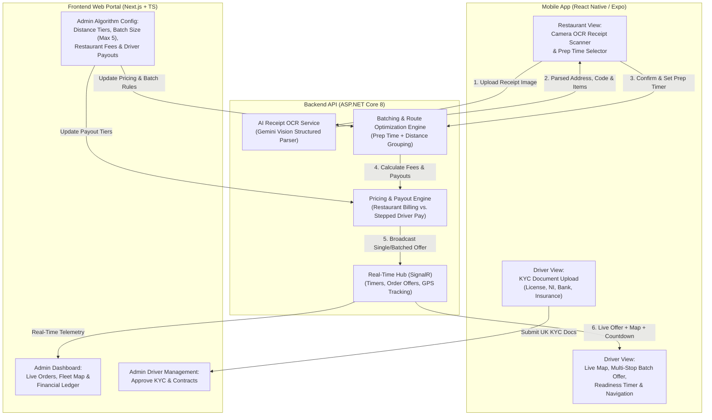

# In Tha Route — Project Context & Product Specification

> **Source Material Analyzed:**
> - User requirements prompt
> - WhatsApp chat transcript ([`_chat.txt`](file:///Users/macbookpro/Desktop/projects/In-tha-route/WhatsApp%20Chat%20-%20Christian%20bark/_chat.txt)) between **Umer (Alpha Devs)** and **Christian (`Christian@inthakitchen.com` / In tha Kitchen Ltd)**
> - Reference video ([`00000069-VIDEO-2026-10-30-16-21-14.mp4`](file:///Users/macbookpro/Desktop/projects/In-tha-route/WhatsApp%20Chat%20-%20Christian%20bark/00000069-VIDEO-2026-10-30-16-21-14.mp4)) demonstrating Deliveroo Rider multi-pickup / multi-dropoff order batching
> - Receipt samples document ([`00000075-Comparatives.docx`](file:///Users/macbookpro/Desktop/projects/In-tha-route/WhatsApp%20Chat%20-%20Christian%20bark/00000075-Comparatives.docx)) containing 9 real UK restaurant delivery receipts (Deliveroo, Uber Eats, Eat Presto)
> - Existing App Store screenshots ([`00000121-PHOTO-2026-10-30-16-51-00.jpg`](file:///Users/macbookpro/Desktop/projects/In-tha-route/WhatsApp%20Chat%20-%20Christian%20bark/00000121-PHOTO-2026-10-30-16-51-00.jpg) & [`00000122-PHOTO-2026-10-30-16-51-01.jpg`](file:///Users/macbookpro/Desktop/projects/In-tha-route/WhatsApp%20Chat%20-%20Christian%20bark/00000122-PHOTO-2026-10-30-16-51-01.jpg))

---

## 1. Executive Summary & Business Overview

**In Tha Route** (operated by **In tha Kitchen Ltd**, UK) is a B2B2C last-mile delivery dispatch, order-batching, and fleet management platform built for restaurants and couriers (initially operating in South-West London: Richmond, Twickenham, Isleworth, Teddington, Hounslow).

Restaurants receive delivery orders from multiple external channels (**Deliveroo**, **Uber Eats**, **Just Eat**, and **in-house POS/website systems** like *Eat Presto*) where the restaurant is responsible for fulfillment (`"Delivery by: restaurant"`).

Currently, restaurants log into Christian's legacy platform (`App.inthakitchen.com`) and **manually type customer addresses** to request a courier. Furthermore, the legacy system is split across a website and two separate mobile apps (*In Tha Route!* and *In tha Kitchen Driver*) containing unused legacy features.

### Goal of the New Platform
Consolidate the platform into **1 Web Portal (`frontend`) + 1 Unified Mobile App (`mobile`) + 1 Core API (`backend`)** that:
1. **Eliminates manual data entry** by letting restaurant staff **scan paper order receipts via mobile AI/OCR**, set a preparation timer, and publish orders live in seconds.
2. **Supports two driver models** within the same architecture:
   - **Restaurant In-House Drivers** (lightweight onboarding, no compliance docs required).
   - **Platform / Open-Pool Drivers** (contracted by the Admin/Owner with full UK KYC document verification).
3. **Intelligently batches & routes multiple orders** (up to **5 orders in a single trip**, configurable by Admin) across one or more restaurants based on preparation time and distance.
4. **Automates multi-order billing & driver payout calculations** so the Admin charges each restaurant per order while paying drivers on a configurable stepped/batched payout curve.

---

## 2. Repository & Technical Stack

| Layer | Folder | Technology Stack | Purpose |
| :--- | :--- | :--- | :--- |
| **Backend API** | [`backend/`](file:///Users/macbookpro/Desktop/projects/In-tha-route/backend) | **ASP.NET Core 8 Web API** (`C#`, `.NET 8.0`) | Core business logic, AI/OCR receipt parsing service, batching & routing engine, pricing/payout calculator, real-time WebSockets (SignalR), auth & KYC storage |
| **Web Portal** | [`frontend/`](file:///Users/macbookpro/Desktop/projects/In-tha-route/frontend) | **Next.js (TypeScript, Tailwind CSS, App Router)** | **Administrator (Owner) Dashboard** & **Restaurant Web Portal** for live dispatch monitoring, driver KYC approval, pricing/algorithm configuration, and financial ledgers |
| **Mobile App** | [`mobile/`](file:///Users/macbookpro/Desktop/projects/In-tha-route/mobile) | **React Native (Expo, TypeScript)** | **Unified Mobile App** with role-based views for **Restaurant Staff** (OCR receipt scanner + prep timer) and **Drivers/Riders** (live map, multi-stop batch offers, navigation, KYC onboarding) |

---

## 3. User Roles & Core Workflows

### 3.1. Restaurant (Establishment)
* **Receipt Scanning (Mobile App Only):**
  * Restaurant staff opens the mobile app and snaps a photo of a printed thermal receipt (from Uber Eats, Deliveroo, Just Eat, or their own POS/website).
  * AI OCR (e.g., Gemini Vision) parses the receipt into structured fields (see Section 4).
  * Staff verifies the extracted address/details, selects the **Preparation Time** (e.g., 15, 20, 30, 40 mins), and submits.
* **Live Order & Prep Countdown:**
  * Once submitted, the **Order Goes Live** and a **Preparation Countdown Timer** starts immediately.
  * This countdown timer is synchronized in real time with the Driver App and Admin Dashboard so couriers arrive right when the food is ready.
* **Driver Policy Configuration:**
  * **Own Drivers Policy:** Restaurant dispatches orders to its own in-house drivers. Restaurant can add its own drivers easily with minimal fields (name, phone, login) and **no document upload requirements**.
  * **Open / Platform Driver Policy:** Order is broadcast to the platform's registered pool of couriers (or auto-grouped by the batching algorithm).

### 3.2. Riders / Drivers (Two Distinct Categories)
Both driver types use the same mobile app interface for delivery execution, but have different onboarding and assignment rules:

| Feature | Type 1: Restaurant's Own Driver | Type 2: Platform (Admin-Contracted) Driver |
| :--- | :--- | :--- |
| **Who registers them?** | Added directly by the Restaurant (or Admin) | Self-applies via Mobile App; approved & contracted by Admin |
| **Document / KYC Required?** | **No** — frictionless creation without document requests | **Yes (Mandatory UK KYC):**<br>• Driver's License<br>• Bank Account Details<br>• National Insurance (NI) Number<br>• Vehicle Insurance Certificate<br>• Personal / Company ID Document |
| **Order Eligibility** | Assigned to orders from their home restaurant | Can opt-in / accept open orders & multi-restaurant batches across the platform |
| **Payout Model** | Handled internally by the restaurant | Paid by Admin per the Platform Batch Payout Algorithm |

### 3.3. Administrator (Platform Owner — Christian)
* **Driver Contracting & KYC Verification:** Reviews applications and uploaded compliance documents from Platform Drivers, approves/suspends accounts, and manages contracts.
* **Restaurant Onboarding & Billing Rules:** Manages establishments, their driver policy (in-house vs. open platform couriers), and per-restaurant fee schedules.
* **Algorithm & Pricing Parameterization:**
  * Configures distance tiers (e.g., base fee up to 2 miles, extra mileage rates).
  * Configures **Max Orders per Batch** (currently **5 orders max** per trip, with ability to increase in the future).
  * Configures the **Stepped Batch Payout & Restaurant Charge Matrix** (how much the restaurant pays vs. how much the driver earns for Order #1, #2, #3, #4, #5 in a batch).
  * Configures batching thresholds (max detour distance, max prep-time difference).
* **Live Fleet & Dispatch Map:** Real-time visibility into active orders, preparation countdowns, batched routes, and courier GPS locations.

---

## 4. Analysis of Real Receipts (`Comparatives.docx`) & OCR Data Model

From the 9 thermal receipt photos provided by the client in [`00000075-Comparatives.docx`](file:///Users/macbookpro/Desktop/projects/In-tha-route/WhatsApp%20Chat%20-%20Christian%20bark/00000075-Comparatives.docx), restaurants scan three distinct receipt layouts:

| Source Channel | Sample Order IDs | Key Fields Present on Receipt | Special Nuances to Handle in OCR |
| :--- | :--- | :--- | :--- |
| **Deliveroo** | `#8680`, `#3895`, `#9555`, `#2629` | • Delivery time (`18:15`, `19:53`)<br>• Customer short name (`Anna T.`, `Pete A.`, `Vijay B.`, `Malcolm F.`)<br>• Proxy phone + access code (`+442033195035 #001902799`)<br>• Street address & UK Postcode (`19 Rosemont Rd, Richmond, TW10 6QN`)<br>• Delivery notes (`Ring the doorbell`, `ADD CUTLERY`)<br>• Items, prices, Subtotal/Total<br>• Footer: `Delivery by: restaurant` | Uses a shared Deliveroo proxy phone number (`+442033195035`) paired with a unique **8-digit Phone Access Code** (`#001902799`) that the driver must dial to reach the customer. |
| **Uber Eats** | `#3B274`, `#79067`, `#D077A` | • Delivery time (`20:35`, `17:34`, `17:26`)<br>• Customer short name (`Steve J.`, `Shalini L.`, `Rob T.`)<br>• Proxy phone + PIN (`+441388436844 #885 20 125`)<br>• Full address + detailed flat/intercom notes (`Use the intercom at Yeoman Villa entrance for flat number 7 phone number is 7919077221`)<br>• Items, Subtotal/Total<br>• Footer: `Delivery by: restaurant` | Uses an Uber Eats proxy phone (`+441388436844`) + **8-digit ID/PIN** (`#885 20 125`), and customers often write direct mobile numbers or intercom instructions inside the address block. |
| **Restaurant POS / Website (`Eat Presto`)** | `WRZMC65601` (`Order 1.2412`), `FZWVW63353` (`Order 1.2409`) | • Payment status (`Paid`)<br>• Explicit prep target (`Prepare by 6:55 pm (40min) A05`)<br>• Customer full name (`Manu Sareen`, `Georgina Dumler`)<br>• Direct UK mobile (`07766886124`, `07906062965`)<br>• Street address & UK Postcode (`68 Saint Mary's Crescent, Isleworth, TW7 4NA`)<br>• Categorized items (`starters`, `mains`, `other`) & Total (`90.00`) | Customer details and address appear at the **bottom** of the receipt rather than the top, and include an explicit `Prepare by <time> (<X>min)` line. |

> [!TIP]
> **Handwritten Annotations on Receipts:** Notice the handwritten numbers at the top of the client's sample receipts (`1`, `1.5`, `2`, `2.5`, `4.00`) representing mileage/pricing zones manually calculated today. Our geocoding + distance engine will calculate this automatically from Restaurant Coordinates $\rightarrow$ Customer Postcode/Address.

### Required OCR Output Schema
When the mobile app scans a receipt and sends it to the `.NET 8` backend (using Gemini Vision structured JSON output), the parser should extract:
```json
{
  "sourcePlatform": "Deliveroo | UberEats | JustEat | WebsitePOS | Unknown",
  "externalOrderId": "#8680",
  "customerName": "Anna T.",
  "customerPhone": "+442033195035",
  "phoneAccessCode": "001902799",
  "deliveryAddress": "19 Rosemont Rd, Richmond, London",
  "postcode": "TW10 6QN",
  "deliveryInstructions": "ADD CUTLERY. Phone access code: 001902799",
  "suggestedPrepMinutes": 40,
  "targetDeliveryTime": "18:15",
  "orderTotalGbp": 51.25,
  "items": [
    { "quantity": 1, "name": "Papad Basket and Pickle Tray", "price": 6.00 }
  ]
}
```

---

## 5. Multi-Order Batching, Routing & Pricing Algorithm

### 5.1. Deliveroo-Style Multi-Stop Rider Experience
Based on Christian's screen recording ([`00000069-VIDEO-2026-10-30-16-21-14.mp4`](file:///Users/macbookpro/Desktop/projects/In-tha-route/WhatsApp%20Chat%20-%20Christian%20bark/00000069-VIDEO-2026-10-30-16-21-14.mp4)):
1. **Batch Offer Screen:**
   * Displays total guaranteed driver earnings in large text (e.g., **`£8.80`**) and total stop count (e.g., **`4 stops`**).
   * Lists all **Collection Points (Restaurants)** with names and postcodes (e.g., *Amorino - Richmond, 5 The Quadrant, TW91BP* & *Saffron Restaurant - Richmond, 5 Dome Buildings The Square, TW91DT*).
   * Provides an expandable **`Multiple drop-offs (N stops) >`** sheet showing the customer delivery addresses (*6 Hounslow Road, TW27EX*, *7 Yew Tree Walk, TW45HT*).
   * Renders a dark-mode interactive map with **Store Pickup Pins**, **Customer Drop-off Pins**, and the **Route Polyline**.
   * **Accept** / **Decline** buttons.
2. **Active Delivery & Readiness Timer:**
   * Shows step-by-step leg navigation (`Go to restaurant` $\rightarrow$ `Travel 1.4 mi to collect`), restaurant pickup instructions, and the **live countdown timer** indicating when each order will be ready for collection.

### 5.2. Batching Criteria
The backend grouping engine evaluates live orders and groups up to **`MaxBatchSize` (default: 5)** orders for a single courier when:
* **Pickup Proximity:** Restaurants are either the same establishment or within configurable distance $D_{\text{pickup}}$ (e.g., $\le 0.8$ miles apart).
* **Prep Time Alignment:** Order readiness timestamps (`ReadyAt = CreatedAt + PrepMinutes`) fall within a configurable window $\Delta T_{\text{prep}}$ (e.g., $\le 10\text{–}15$ minutes apart) so food does not sit cold waiting for a second restaurant.
* **Drop-off Corridor / Route Compatibility:** Customer drop-offs lie along a compatible directional corridor or within max detour distance $D_{\text{dropoff}}$.

### 5.3. Financial Calculation Engine (Restaurant Charge vs. Driver Payout)
Per Christian's specification (`_chat.txt` lines 180–188):
* **Restaurant Charge ($C_i$):** Each restaurant is charged based on the order's pickup-to-dropoff distance bracket (e.g., **£5.00** for a trip up to 2 miles), **regardless of whether the order is batched with another restaurant's order**.
* **Driver Payout ($P_k$):** When a platform driver completes a batch of $N$ orders ($1 \le N \le 5$), the driver is paid according to a configurable **tiered batch schedule** based on the order's position $k \in \{1, \dots, N\}$ in the batch (plus any distance surcharges):

#### Worked Example (2-Order Batch up to 2 miles)
| Order Position in Batch ($k$) | Charged to Restaurant ($C_k$) | Paid to Driver ($P_k$) | Platform Margin ($C_k - P_k$) |
| :--- | :---: | :---: | :---: |
| **Order #1** (Base Order) | £5.00 | £4.00 *(or £4.20)* | £1.00 *(or £0.80)* |
| **Order #2** (Appended in Batch) | £5.00 | £3.20 | £1.80 |
| **Batch Total (2 Orders)** | **£10.00** | **£7.20** *(or £7.40)* | **£2.80** *(or £2.60)* |

#### Parameterized Multi-Order Formula (Up to $N_{\max} = 5+$ Orders)
In the Administrator Portal, the Owner can configure:
1. **Distance Tiers:** Base distance (e.g., `0 - 2.0 miles`) and per-mile surcharge beyond base distance (for both Restaurant Fee and Driver Payout).
2. **Batch Sequence Payout Table:**
   - `Order 1`: Base Driver Payout (e.g., `£4.00`)
   - `Order 2`: 2nd Batched Order Payout (e.g., `£3.20`)
   - `Order 3`: 3rd Batched Order Payout (e.g., `£2.80` — *Admin configurable*)
   - `Order 4`: 4th Batched Order Payout (e.g., `£2.50` — *Admin configurable*)
   - `Order 5`: 5th Batched Order Payout (e.g., `£2.20` — *Admin configurable*)
   - `MaxBatchOrders`: `5` (adjustable upward in Admin Settings)

$$\text{Total Restaurant Revenue} = \sum_{k=1}^{N} C(\text{distance}_k), \qquad \text{Total Driver Payout} = \sum_{k=1}^{N} P(k, \text{distance}_k)$$

---

## 6. High-Level System Architecture



---

## 7. Open Questions & Items to Confirm with Client (Christian)

1. **Cab / Ride Negotiation Module (`_chat.txt` line 35):**
   * In his first message on Oct 2, Christian mentioned: *"In the cab module, the user will choose the nearest driver, and a dialogue box will open between them so they can negotiate the fare and the destination."*
   * In later messages (Oct 30), he focused exclusively on restaurant receipt OCR, multi-stop food delivery batching, and the two driver types, and noted *"there's some tools I want to remove and you don't need to build up"*.
   * **Action:** Confirm whether the Cab negotiation module is still in scope for Phase 1 or if the platform is strictly focused on restaurant courier dispatch.
2. **Order Assignment Mode (Open Claim vs. Auto-Dispatch Offer):**
   * Confirm whether open platform orders are **offered to the best-matched driver** with an Accept/Decline timer (like the Deliveroo video) or listed on an **open job board** where any nearby registered driver can opt-in/claim up to 5 orders. (Supporting both or hybrid mode is straightforward).
3. **Restaurant Portal Access:**
   * Christian mentioned *"Scanner should be available only through mobile app"* and *"The platform will be 1 website and 1 app"*. Confirm if restaurants only use the Mobile App (for scanning + setting prep time + adding their own drivers) or if they also log into the Web Portal for billing/order history.

